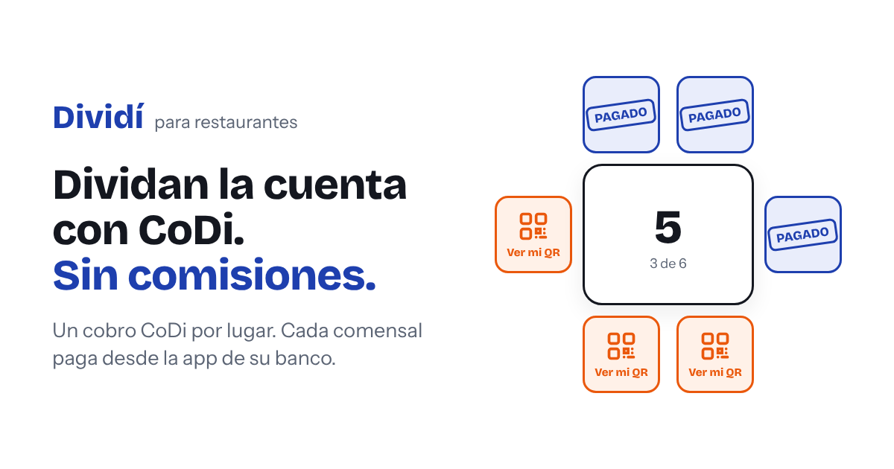

# Dividí

**Dividan la cuenta con CoDi. Sin comisiones.**



Dividí es una app web para restaurantes. El mesero toca la mesa y la app genera un cobro CoDi por lugar. Cada comensal paga desde la app de su banco y su lugar se marca PAGADO solo. El restaurante recibe el pago completo, de banco a banco, sin comisión de terminal.

- **Demo en vivo:** https://divide-la-cuenta-two.vercel.app
- **Código de mesero de la demo:** 1234 (también aparece en la pantalla de entrada)
- Proyecto para el Cursor Hackatón México (AI Builders México y pey, noviembre 2026). Usa la API de [pey](https://docs.pey.mx).

## Cómo usa la API de pey

| Qué hace Dividí | pey |
| --- | --- |
| Un cobro CoDi por lugar, con `numRef` único y `metadata` de la mesa | `POST /codi/qr` |
| Cobro enviado a la app del banco del comensal, sin escanear (CoDi por notificación) | `POST /codi/pn` |
| Confirmación del pago en el servidor: firma verificada (Standard Webhooks), sin duplicados por `transactionId` y validando el monto | Webhooks `codi.qr.payment_received` y `codi.pn.payment_received` |
| Red de seguridad: si un webhook se retrasa o se pierde, el servidor le pregunta a pey por cada cobro pendiente, cada 15 segundos o cuando el mesero toca "Verificar pagos con pey" | `GET /transaction/codi/qr/:id` y `GET /transaction/:id` |

El pago nunca se confirma en el navegador. La bitácora de cada mesa dice cómo se confirmó cada pago: por webhook (y en cuántos segundos avisó pey) o por consulta. Con una API key real, un webhook sin firma se rechaza. El celular para el cobro por notificación se manda a pey y no se guarda.

## Cómo funciona


1. El mesero entra con su código y ve las mesas del restaurante demo, Wingman Dinner.
2. Toca una mesa, confirma el consumo, elige la propina y marca los lugares que pagan (A, B, C...).
3. La app crea un cobro CoDi por lugar y muestra la mesa vista desde arriba, con un botón por lugar. Abajo de la pantalla es donde está parado el mesero.
4. El mesero toca "Modo comensal" y acerca la pantalla. Cada comensal toca su lugar: su QR se abre grande, uno a la vez, para que nadie escanee el del vecino. También puede escribir su celular y recibir el cobro en su banco.
5. Al confirmarse el pago, el comensal ve "Pago recibido" y su lugar queda con el sello PAGADO.
6. Si alguien paga en efectivo o con tarjeta, el mesero lo registra con su código. Cuando todos pagan aparece "Mesa pagada".

## Cómo probarlo

1. Abre la demo y entra con el código 1234.
2. Toca una mesa libre, por ejemplo la Mesa 2.
3. Consumo 0.04, "Sin propina", "En partes iguales", toca los 4 lugares y genera los cobros.
4. Toca un lugar, escanea el QR con CoDi en la app de tu banco y paga $0.01. El lugar se marca PAGADO sin recargar.
5. Cierra los demás lugares con "Efectivo" o "Tarjeta".

La demo cobra con CoDi real, por eso conviene probar con centavos. Las mesas que aparecen ocupadas o pagadas al abrir son datos de ejemplo, y el total del tablero lo dice. Los pagos de prueba llegan a la cuenta de prueba asignada por el hackatón.

## Lo que todavía no hace

- Divide solo en partes iguales, no por consumo.
- Los comensales pagan viendo la pantalla del mesero. Falta que cada quien abra su cobro en su propio celular.
- Un restaurante real usaría sus propias credenciales de pey y su propia CLABE. Dividí no cobra a nombre de terceros ni concentra pagos.
- La comisión cero aplica a los pagos con CoDi. Si alguien paga con tarjeta, la app solo lo registra.

## Componentes previos y de terceros

Todo el código se construyó el 14 de noviembre de 2026, durante el hackatón. No hay componentes previos.

De terceros: Next.js y React (MIT), Tailwind CSS (MIT), `@upstash/redis` (MIT) con Upstash Redis para el estado, `standardwebhooks` (MIT) para verificar la firma, `qrcode.react` (ISC) para dibujar el QR, y las fuentes Bricolage Grotesque e Instrument Sans (SIL OFL). Desplegado en Vercel. Construido con Claude.

## Correr localmente

```bash
npm install
cp .env.example .env.local   # sin PEY_API_KEY corre en modo demo
npm run dev
```

Sin `PEY_API_KEY` la app corre en modo demo: los QR son falsos y aparece el botón "Simular CoDi".

| Variable | Para qué |
| --- | --- |
| `PEY_API_KEY` | API key de pey |
| `PEY_WEBHOOK_SECRET` | Secreto para verificar la firma del webhook |
| `WAITER_PIN` | Código de mesero. Sin esta variable se usa el código de demo 1234 |
| `DEMO_MODE` | Con valor `1` fuerza el modo demo aunque exista `PEY_API_KEY` |
| `KV_REST_API_URL`, `KV_REST_API_TOKEN` | Upstash Redis (Vercel los agrega solos) |

Webhook a configurar en pey: `https://TU-APP.vercel.app/api/webhooks/pey`
