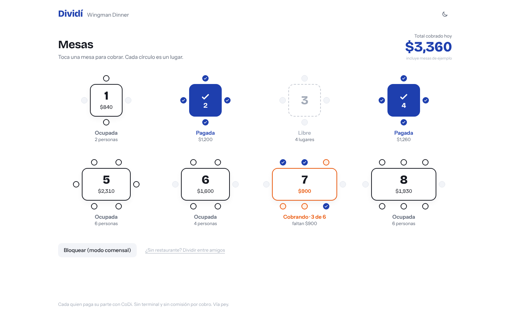

# Dividí

**Cada quien paga su parte con CoDi. Sin terminal y sin comisión por cobro.**

Dividí es una app web para restaurantes. El mesero toca la mesa, marca los lugares ocupados y la app genera un QR de CoDi por persona, cada uno en la posición de su lugar. Cada comensal paga desde la app de su banco y su lugar se marca como PAGADO en vivo. Usa la API de [pey](https://docs.pey.mx).



Proyecto para el Cursor Hackatón México (AI Builders México y pey, noviembre 2026). Demo en vivo: https://divide-la-cuenta-two.vercel.app (código de mesero de la demo: 1234).

## Cómo funciona

1. El mesero entra con su código y ve el tablero de mesas del restaurante demo, Wingman Dinner.
2. Toca una mesa, confirma el consumo, elige la propina (ninguna opción viene marcada) y marca los lugares que pagan.
3. Por cada persona se crea un cobro con `POST https://api.pey.mx/codi/qr` y una referencia numérica única (`numRef`).
4. La pantalla muestra la mesa vista desde arriba con un botón por lugar. El QR real se abre grande solo al tocar el lugar, para que nadie escanee el del vecino. Abajo de la pantalla es donde está parado el mesero. El botón "Modo comensal" bloquea las acciones del mesero mientras los comensales ven la pantalla.
5. Cada quien toca su lugar y escanea su QR con la app de su banco.
6. pey avisa al servidor con el webhook `codi.qr.payment_received`. El servidor verifica la firma (Standard Webhooks), ignora duplicados por `transactionId` y marca ese lugar como pagado. El pago nunca se confirma en el navegador.
7. El mesero también puede marcar efectivo o tarjeta. Cuando todos pagan aparece "Mesa pagada", y la bitácora muestra cada pago y cuánto tardó pey en avisar.

También hay un modo secundario para dividir una cuenta entre amigos, sin restaurante. Generar cobros siempre pide el código de mesero.

La comisión cero aplica a los pagos por CoDi. La API de pey no tiene costo por el momento.

## Cómo probarlo

- La demo cobra con CoDi real. Para probar un pago completo, crea una cuenta de centavos (por ejemplo consumo de $0.02 entre dos lugares) y paga un QR con la app de tu banco.
- Las mesas que aparecen ocupadas o pagadas al abrir son datos de demostración.
- Sin `PEY_API_KEY` la app corre en modo demo: los QR son falsos y aparece el botón "Simular CoDi".

## Stack y componentes de terceros

Todo el código se construyó el 14 de noviembre de 2026, durante el hackatón. No hay componentes previos.

Next.js (App Router) y React, Tailwind CSS, Upstash Redis para el estado, `standardwebhooks` para verificar la firma, `qrcode.react` para dibujar el QR, y las fuentes Bricolage Grotesque e Instrument Sans (`@fontsource-variable`). Desplegado en Vercel. Construido con Claude.

## Correr localmente

```bash
npm install
cp .env.example .env.local   # opcional: sin PEY_API_KEY corre en modo demo
npm run dev
```

## Variables de entorno

| Variable | Para qué |
| --- | --- |
| `PEY_API_KEY` | API key de pey |
| `PEY_WEBHOOK_SECRET` | Secreto para verificar la firma del webhook |
| `WAITER_PIN` | Código de mesero. Sin esta variable se usa el código de demo 1234 |
| `DEMO_MODE` | Con valor `1` fuerza el modo demo aunque exista `PEY_API_KEY` |
| `KV_REST_API_URL`, `KV_REST_API_TOKEN` | Upstash Redis (Vercel los agrega solos) |

Webhook a configurar en pey: `https://TU-APP.vercel.app/api/webhooks/pey`

## Pendientes conocidos

Cobro por notificación de CoDi al celular, vista del comensal en su propio teléfono, propina elegida por cada persona, alta de restaurantes con su propia CLABE y cierre de turno.
